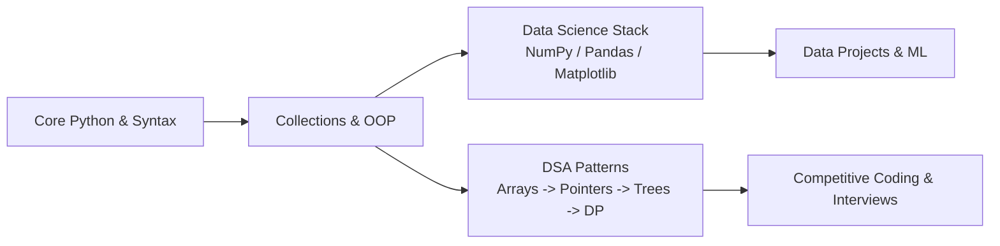

# 🚀 ZaidLearn

[](https://www.python.org/)
[](https://isocpp.org/)
[](https://jupyter.org/)
[](file:///d:/zaidsystem/02_Coding/04_Learning/TRACKER.md)

> A structured, hands-on repository dedicated to mastering **Python**, **Data Science Libraries** (NumPy, Pandas, Matplotlib), and **Data Structures & Algorithms (DSA)** with complete progress tracking.

---

## 🧭 Repository Map

| Section | Focus Area | Path |
|---|---|---|
| 🧠 **DSA Mastery** | Problem solving following NeetCode 150 & Striver A2Z | [`DSA/`](file:///d:/zaidsystem/02_Coding/04_Learning/DSA/) |
| 📊 **Python Libraries** | NumPy, Pandas, Matplotlib, Seaborn interactive notebooks | [`Python Library/`](file:///d:/zaidsystem/02_Coding/04_Learning/Python%20Library/) |
| 🐍 **Python Core** | Basics, functions, OOP, collections, pattern printing | [`python/`](file:///d:/zaidsystem/02_Coding/04_Learning/python/) |
| 📐 **Pattern Logic** | Nested loops, geometric and alphanumeric patterns | [`Pattern Programming/`](file:///d:/zaidsystem/02_Coding/04_Learning/Pattern%20Programming/) |
| ⚙️ **C & C++ Foundations** | Systems fundamentals, pointers, memory, foundational syntax | [`C/`](file:///d:/zaidsystem/02_Coding/04_Learning/C/) & [`C++/`](file:///d:/zaidsystem/02_Coding/04_Learning/C%2B%2B/) |
| 📈 **Master Tracker** | Daily logs, checklist of mastered topics, problem stats | [`TRACKER.md`](file:///d:/zaidsystem/02_Coding/04_Learning/TRACKER.md) |

---

## 🎯 Quick Roadmap & Goals



### 1. Data Structures & Algorithms
- **Target**: 150 curated problems (NeetCode 150 / Striver A2Z).
- **Format**: Clean intuition write-ups + solution + time & space complexity analysis.
- **Templates**:
  - Python: [`DSA/templates/problem_template.py`](file:///d:/zaidsystem/02_Coding/04_Learning/DSA/templates/problem_template.py)
  - C++: [`DSA/templates/problem_template.cpp`](file:///d:/zaidsystem/02_Coding/04_Learning/DSA/templates/problem_template.cpp)

### 2. Python & Libraries Deep-Dive
- **NumPy**: Vectorized arrays, broadcasting, linear algebra.
- **Pandas**: Data cleaning, indexing (`loc`/`iloc`), aggregation (`groupby`), joins.
- **Matplotlib & Seaborn**: Statistical visualizations, customized plots, subplots.

---

## 🛠️ Environment Setup

This project uses [`uv`](https://github.com/astral-sh/uv) for fast, modern Python package management:

```bash
# 1. Install dependencies
uv sync

# 2. Launch Jupyter Notebook / Lab
uv run jupyter lab
# or
uv run jupyter notebook

# 3. Run any Python script
uv run python path/to/script.py
```

---

## 📋 How to Log Progress

1. Whenever you solve a problem, copy the starter template from [`DSA/templates/`](file:///d:/zaidsystem/02_Coding/04_Learning/DSA/templates/).
2. Save it in the respective topic folder (e.g., `DSA/01_Arrays_and_Hashing/two_sum.py`).
3. Add a record to [`TRACKER.md`](file:///d:/zaidsystem/02_Coding/04_Learning/TRACKER.md) to update your stats!
